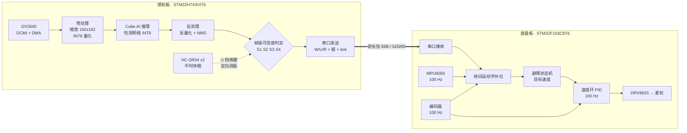

# 系统架构

> 状态：**设计稿 v0.1**（2026-10-26）。除标注"已测"的数字外，其余为设计值或估算，实测后回填。
> 相关：[ADR-0001 双板架构](../02_过程记录/决策记录/ADR-0001_双板架构.md) ｜ [硬件选型](02_硬件选型与资源账.md)

---

## 一、一句话

**感知板负责"看并判断自己靠不靠得住"，底盘板负责"按判断结果动"。** 两板之间只传结论，不传图像。

---

## 二、框图

---

## 三、任务划分（FreeRTOS）

### 感知板（H743）

| 任务 | 优先级 | 周期 / 触发 | 栈 | 干什么 | 预算 |
|---|---|---|---|---|---|
| `task_capture` | 高 | 200 ms | 512 B | 触发 DCMI+DMA 抓帧，等 VSYNC 完成 | 15 ms |
| `task_infer` | 高 | 事件（帧就绪） | 2 KB | 预处理 → 推理 → 后处理 | 200 ms（待实测） |
| `task_judge` | 中 | 事件（推理完成） | 1 KB | 算 S1–S4，出三档，组包发串口 | 5 ms |
| `task_sonar` | 中 | 事件（U 档） | 512 B | 定向测距 3 次，回填复核结果 | 60 ms |
| `task_heart` | 低 | 1 s | 256 B | 心跳包（含 tick 与状态），供时钟对齐 | 1 ms |

**为什么推理要单独一个任务**：推理是不可抢占的长任务（约 200 ms），如果和控制放在同一个任务里，控制环会被拖到 5 Hz。分开之后，底盘板的 100 Hz 控制完全不受感知板阻塞——**这也是双板架构最大的好处**。

### 底盘板（F103）

| 任务 | 优先级 | 周期 | 干什么 |
|---|---|---|---|
| `task_ctrl` | 最高 | 10 ms（100 Hz） | 读编码器/IMU → 补位推演 → 避障状态机 → PID → PWM |
| `task_comm` | 高 | 事件（串口中断） | 收感知包、更新目标、回传 (v, ω) |
| `task_log` | 低 | 100 ms | 环形缓冲记录，供离线分析（**每个决策都留痕，否则误动作率算不出来**） |

---

## 四、板间协议（v0.1，定长小包）

**设计约束**：4 fps 下带宽不是问题（每包 < 32 B × 4/s = 128 B/s），真正的约束是**最坏时延**和**解析开销**。所以用定长、无转义、带 CRC 的二进制包，不用 JSON。

**感知 → 底盘（每帧一包）**

| 偏移 | 长度 | 字段 | 说明 |
|---|---|---|---|
| 0 | 1 | `0xA5` | 帧头 |
| 1 | 1 | `ver` | 协议版本 |
| 2 | 1 | `grade` | 0=W 可用 / 1=U 存疑 / 2=R 弃用 |
| 3 | 1 | `n_box` | 框数量（0–4） |
| 4 | 4 | `tick_ms` | 出帧时刻（感知板 tick，用于对齐） |
| 8 | 4 | `score_q` | 主框置信度（Q7.8 定点） |
| 12 | 16 | `boxes` | 最多 4 个框，每框 x,y,w,h 各 1 B（按 192 归一化到 0–255） |
| 28 | 2 | `crc16` | CRC-16/CCITT |

**底盘 → 感知（每 100 ms 一包）**

| 偏移 | 长度 | 字段 |
|---|---|---|
| 0 | 1 | `0x5A` |
| 1 | 1 | `ver` |
| 2 | 4 | `tick_ms` |
| 6 | 2 | `v_q`（mm/s，int16） |
| 8 | 2 | `w_q`（0.01 rad/s，int16） |
| 10 | 1 | `state`（底盘状态机当前档） |
| 11 | 2 | `crc16` |

**时钟对齐**：两板各用自己的 tick。底盘每次收到心跳包，用"收到时刻 − 包内 tick"更新偏移估计，做一阶低通。误差目标 **< 5 ms**（M10 验收项）。**不做 NTP 那套**，我们只需要相对时间。

---

## 五、时序预算（M3 要实测填满的表）

以 240 ms 端到端为目标（对齐 [R1] 的复现数据）：

| 阶段 | 预算 | 怎么测 | 实测 |
|---|---|---|---|
| 抓帧 + DMA 传输 | 15 ms | GPIO 翻转 + 逻辑分析仪 / DWT 计数 | 待测 |
| 预处理（缩放 + 量化） | 10 ms | DWT | 待测 |
| **推理本体** | 190 ms | Cube.AI 自带 cycle 计数 | 待测 |
| 后处理（反量化 + NMS） | 15 ms | DWT | 待测 |
| 判定 + 组包 + 串口 | 5 ms | DWT | 待测 |
| 串口传输（1200 B @115200） | ~10 ms | 示波器看首尾字节 | 待测 |
| **合计** | **≈ 245 ms** | | |

> 这张表是 M3 的核心交付物。**预算值是我按文献比例估的，不是实测**——第一版数据出来后整张表重写。

---

## 六、数据流的关键设计选择

**1. 两板之间不传图像。** 传图需要 MB/s 级带宽，而且底盘板根本没有内存处理图像。传结论（框 + 三档）只要 32 B。

**2. 三档判定在感知板做，动作决策在底盘板做。**
判定属于"感知的可信度"，跟模型绑在一起；动作属于"车怎么动"，跟底盘绑在一起。**边界清楚，才能各自独立测试。**

**3. 超声挂感知板，不挂底盘板。**
因为复核是"对准某个框的方位测距"，需要知道框在哪——框在感知板手里。代价是超声的时序与推理争中断，所以超声只在 U 档触发，且不在推理进行中触发。

**4. 帧间补位在底盘板做。**
它本质是控制需求（补 100 Hz 控制环的输入），不是感知需求。放在底盘板还有个好处：**IMU 和编码器就在本地，不用跨板传**。

**5. 所有决策留痕。** 底盘板 100 ms 记一条（时间、档位、目标速度、实际速度、最近距离），环形缓冲 2000 条（200 s），可离线导出。**没有这个日志，误动作率永远算不出来。**

---

## 七、明确的边界（不做什么）

- 不做 SLAM、不做路径规划——只在"看见障碍就减速/停"这个层面
- 不做多目标跟踪（tracking）——帧间补位只推主框，不做数据关联
- 不做模型训练（只用开源预训练模型 + 微调/量化）
- 不做 AUTOSAR / 功能安全认证——**答辩时不许说"这是智能驾驶"**，它只是感知层的缩小版

---

## 八、待定项

| # | 待定 | 卡在哪 | 什么时候定 |
|---|---|---|---|
| 1 | 底盘板与感知板的物理连接（排针直插 vs 杜邦线） | 等结构件方案 | M1 |
| 2 | 超声是否需要舵机转向，还是用两个固定角度 | 波束 15°，±30° 覆盖需要 2 个还是 3 个 | M1 |
| 3 | 是否引入 RTOS 或裸机前后台 | 底盘板裸机够用；感知板要 RTOS | M1（倾向：感知板 RTOS，底盘板裸机） |
| 4 | 日志导出的物理通道（UART / SD / 无线） | 影响 M4 的数据量 | M2 |
