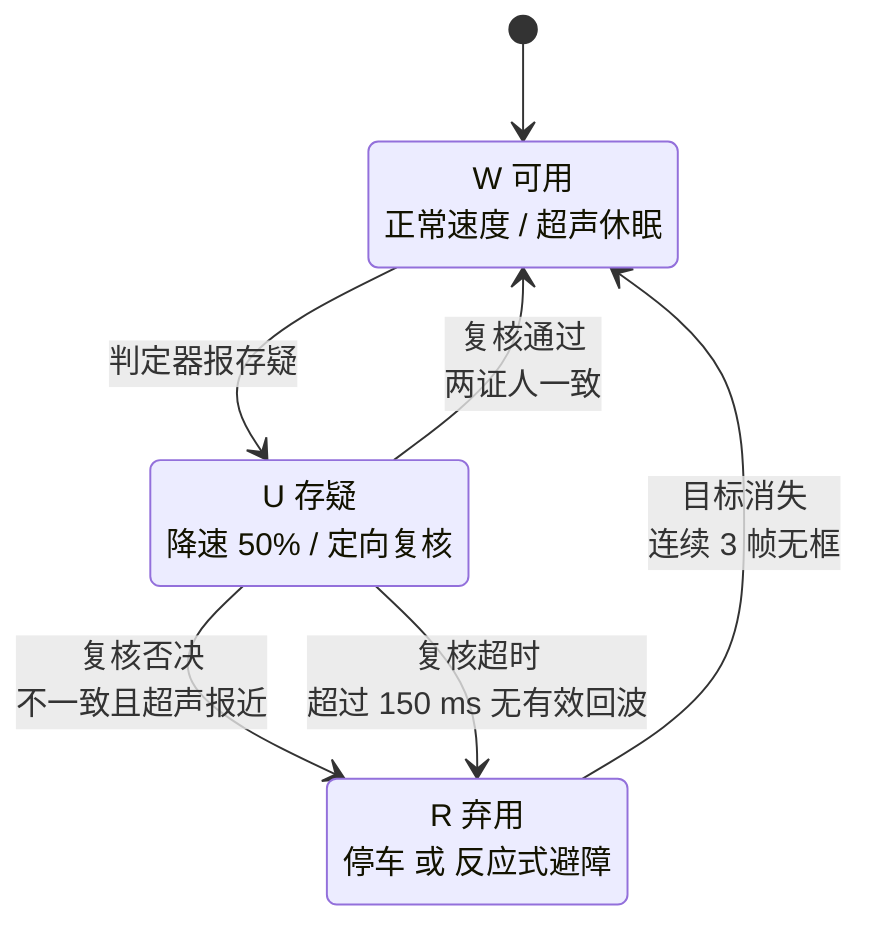

# 创新点 ②：触发式定向复核

> 状态：**设计稿 v0.1**（2026-10-26）。
> 核心主张：**融合的不是权重，是时机。**
> 相关：[帧级可信度判定](03_帧级可信度判定.md) ｜ [ADR-0003 指标口径](../02_过程记录/决策记录/ADR-0003_指标换成误动作率.md)

---

## 一、通行做法错在哪

多传感器融合的标准做法是**加权**：视觉和超声各给一个距离估计，按固定权重（或按场景切权重）平均。

问题在于：**平均会稀释否决权。**

举个具体的。车速 0.3 m/s，前方 40 cm 有一个物料盒。超声测到 38 cm（准的），视觉这一帧因为逆光把盒子误判成 80 cm 远（错的）。两者按 0.5/0.5 融合：

```
(38 + 80) / 2 = 59 cm
```

**真实的 38 cm 被平均成了 59 cm。** 差的这 21 cm，在 0.3 m/s 下是 0.7 秒——够撞上去。

加权融合的隐含假设是"两个传感器的误差独立且均匀"。而现实是：**视觉的错误往往是成片的、系统性的**（一个逆光场景会连续错十几帧），超声的错误往往是局部的（一次多径反射）。用平均去处理成片的错误，等于让它污染整个估计。

---

## 二、我们的做法：把权重换成时机



**三个动作**

| 档位 | 车做什么 | 传感器状态 |
|---|---|---|
| **W 可用** | 正常速度前行 | **超声休眠**，只有视觉工作 |
| **U 存疑** | **降速 50%**，在框方位 ±30° 内测距 3 次 | 超声被唤醒，当"第二个证人" |
| **R 弃用** | 停车 / 转反应式避障（超声主导，慢速试探） | 视觉退出决策 |

**关键差别**：超声不参与平均，**它只做否决**。两个证人一致才通过；不一致时，**按最保守的那个走**（而不是取中间值）。

---

## 三、复核的判定规则

一次复核 = 对同一个目标做 3 次测距，取中位数（不用平均，避免单次多径跳变污染）。

| 情形 | 判定 | 理由 |
|---|---|---|
| 3 次中位数与视觉距离之差 < max(5 cm, 20%) | **通过**，回 W | 两个证人一致 |
| 差 ≥ max(5 cm, 20%) 且超声更近 | **否决**，进 R | 保守优先：宁可错停，不可错撞 |
| 差 ≥ max(5 cm, 20%) 且超声更远 | **降级保持 U**，下一次复核 | 超声也可能错（多径、斜面反射），给一次重测 |
| 3 次中 < 2 次有效回波，或总耗时 > 150 ms | **超时，进 R** | 测不到 ≠ 没有障碍，按"有障碍"处理 |

**"差多少算不一致"这件事必须在实验前定死**，否则事后可以随便调。5 cm / 20% 的初值是按物料盒尺寸与超声标称精度（±3 mm 理想、实际约 ±1 cm）估的，**M4 实测后回填**。

---

## 四、时延账（这是"不拿安全换时间"要证明的东西）

| 档位 | 时延构成 | 合计（估） |
|---|---|---|
| W | 抓帧 15 + 推理 190 + 后处理 15 + 判定 5 + 串口 10 | **≈ 235 ms** |
| U | W 的 235 + 唤醒与测距 3 次 ≈ 60 + 复核判定 5 + 二次串口 10 | **≈ 310 ms** |
| R | 不依赖视觉，底盘本地反应式（超声直连触发） | **< 50 ms** |

**对比方案（全帧固定融合）**：每帧都测超声，每帧 +30 ms 左右，即 ≈ 265 ms 恒定。

所以我们的代价是：**平均时延略低（超声不常开），最坏时延更高（U 档 310 ms）。**

这必须诚实写在报告里：**在需要复核的那一帧，我们比全帧融合慢 45 ms。** 我们主张这是值得的——因为那 45 ms 换来的是"错误框不会被采信"，而全帧融合在那 45 ms 里仍然用一个被平均污染的距离。

**这条主张必须用数据验证**，见第六节的第二件必证伪的事。

---

## 五、触发率控制（否则总时延反而变大）

如果 60% 的帧都被判 U，平均时延会接近 300 ms 且车一直降速——**方案失效，比不做还差。**

三条机制压住触发率：

1. **判定器阈值按"触发率 ≤ 30%"来标定**（见 [①](03_帧级可信度判定.md) 第五节），不按"召回最高"标。
2. **冷却时间**：对同一目标区域（框中心 20 cm 内）触发后 **200 ms 内不重复触发**，直接沿用上次复核结论。
3. **滞回**：从 U 回 W 需要连续 2 帧通过，避免在阈值附近抖动导致"降速—加速"反复。

**要测的**：实车跑固定路线 20 次，统计触发率、每次触发的目标、冷却命中次数。**如果冷却命中比例很高（比如 > 50%），说明阈值太灵敏，回去调。**

---

## 六、必须证伪的三件事

按"最可能失败"排序：

### ① 触发不能太频繁

- 指标：存疑档占比 ≤ 30%
- 怎么测：实车 20 次跑，数 U/R 帧数占总帧数
- 失败怎么办：调阈值（放松），或加冷却；若放松后召回掉到 50% 以下，说明判定器本身就分辨不出来 → 回到 [①](03_帧级可信度判定.md) 的失败判据

### ② 不能拿安全换时间

- 指标：**W 档的漏检率不得高于全帧固定融合的基线**
- 怎么测：同一批帧，跑两个配置（我们的触发式 vs 全帧融合），比较 W 档漏检率
- 失败怎么办：如果我们的漏检更多，说明"超声大部分时间休眠"漏掉了某些视觉看不见的东西（比如透明物、纯色墙）→ 考虑对特定场景强制开启（这已经是工程设计问题了，可以写进"适用范围"）

### ③ 真能降错

- 指标：视觉误检场景下，**误动作率相对单视觉基线下降 ≥ 50%**
- 怎么测：构造误检场景（逆光、目标边缘、反光地面），跑 20 次，比"关掉复核"与"开复核"的误动作次数
- 失败怎么办：如果降不到 50%，如实报实际数值——**降 25% 也是一个数，别为了凑 50% 去挑场景**

---

## 七、实现要点

| 项 | 做法 | 备注 |
|---|---|---|
| 超声驱动 | 定时器 + 输入捕获，测回波宽度 | 不用 `pulseIn()` 那种阻塞写法——**阻塞 30 ms 会毁掉整个调度** |
| 触发方式 | 感知板 GPIO 触发，输入捕获计时 | |
| 唤醒开销 | HC-SR04 无需"预热"，上电即可测；但**首次测量常不准**，所以每次触发测 4 次，取后 3 次 | 这是实测经验，写在这里免得到时候以为是玄学 |
| 定向覆盖 | v0.1 用 2 个固定安装（左、右各偏约 20°） | ±30° 覆盖是否够，M1 用纸板实测后定；不够加第三个（预算内） |
| 交叉干扰 | 两个超声不能同时触发（会互相听到对方回波） | 串行触发，间隔 ≥ 20 ms |

---

## 八、为什么不做得更"聪明"

想过但没做的三件事，写清楚免得被问：

1. **不做贝叶斯融合**。需要两个传感器的误差模型，我们没有数据支撑，写出来的权重是拍的。
2. **不做学习式触发策略**（用强化学习决定何时唤醒）。数据量和时间都不够，而且失去可解释性。
3. **不做多目标复核**。只复核最高分框。**多目标复核会让时延不可控**，而我们要的是"最坏时延可预测"。

这三条都属于"看起来更高级但不划算"。**在这个项目里，可解释、可预测、能测出来，比高级重要。**
